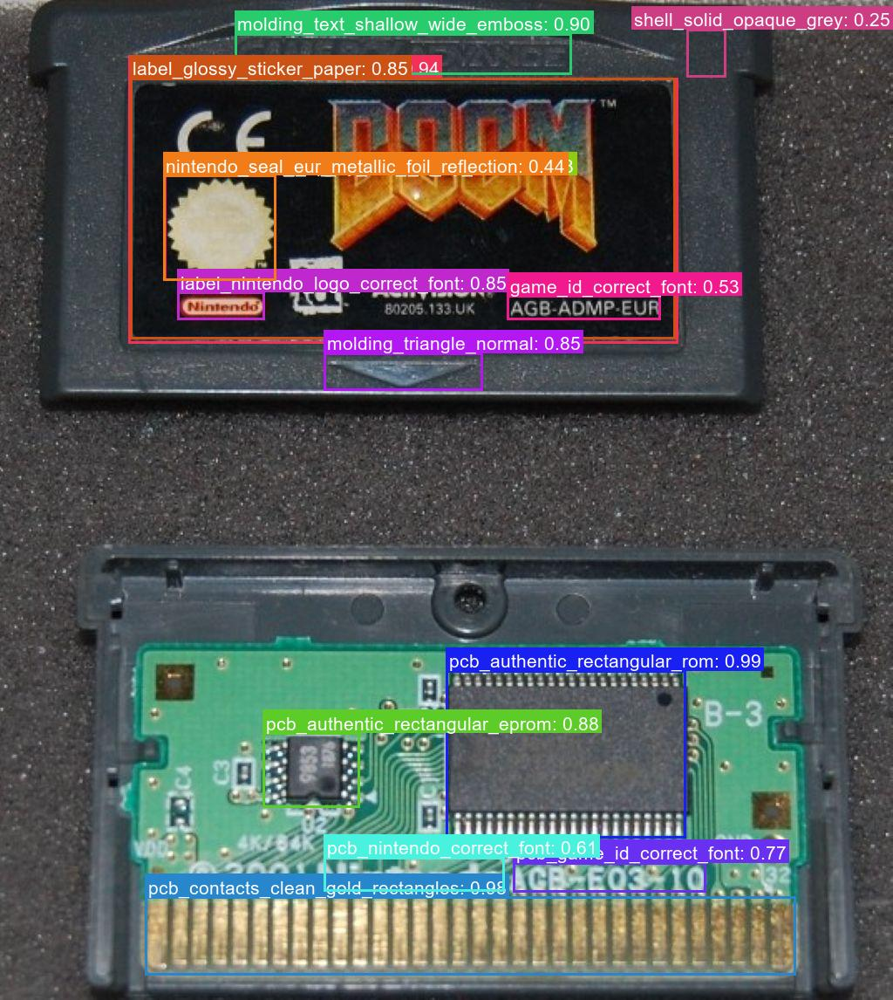
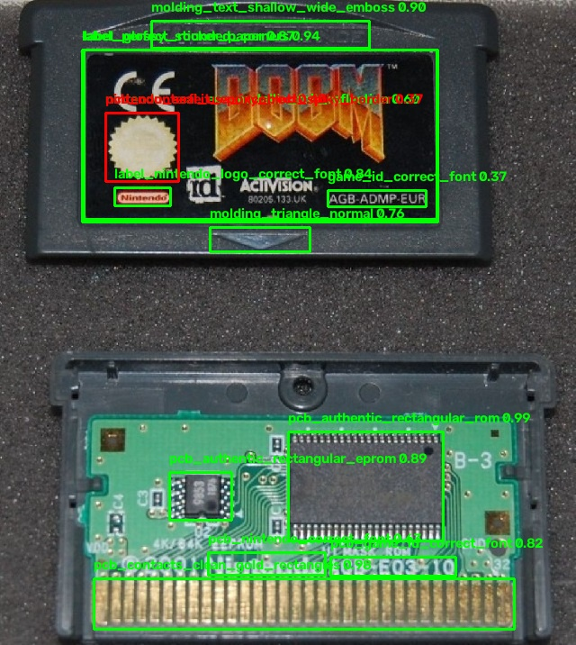
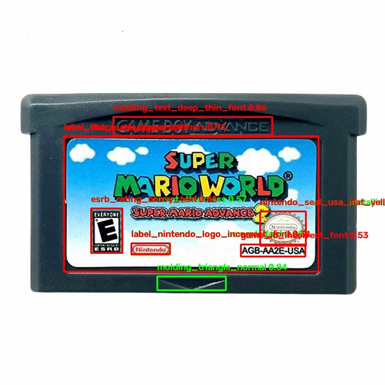

# Cartridge Authentication Models (LibreYOLO)
---
This repository houses various trained Yolo (LibreYOLO) models that identify flaws in physical game cartridges. The code presented in this repostitory are the training scripts, inference scripts, and tags used to identify the flaws

---
## Examples

All of the model examples shown below use the same coloring system to identify flaws in the game cartridge:
- Red box = Inauthentic features
- Green box = Authentic features

**NOTE:** Many of the models are trained to identify flaws as they see them. Using raw model outputs is not enough to guage whether or not a cartridge is authentic or not. (Due to many environmental factors that can affect output such as missing or torn labels, or cartridges thet were produced with epoxy blobs authentically, a weighting system should be used to determine true authenticity.)

Also note that these images are not mine, they are publicly available images from Reddit on the <a href="https://www.reddit.com/r/gameverifying/">r/gameverifying</a> subreddit.

### GBA

The GBA model identifies common flaws in inauthentic cartidges for the Nintendo Gameboy Advance handheld console.

|Inference | Authenticity |
|----------|--------------|
||Authentic|
||Inauthentic|